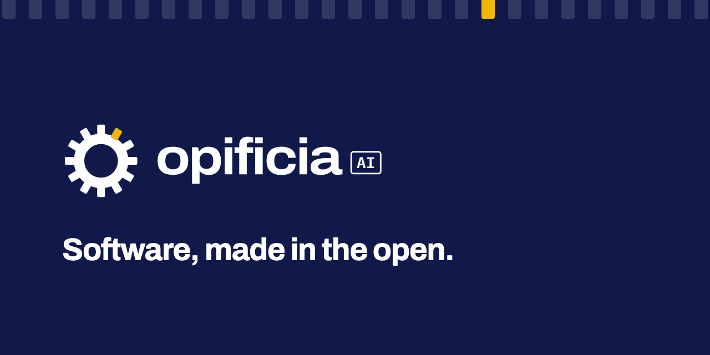

Opificia AI is an open-source software factory: AI agents turn tickets into reviewed, tested pull requests, on infrastructure and models you control.

> **Early stage.** No usable release yet. We are building in the open.

## What it is

Opificia is a platform where AI agents pick up a ticket, write the change, run the tests and open a pull request. A human reviews that pull request and decides whether it is merged. You run Opificia on servers you choose, with models you choose, including open-weight models (models whose trained weights are published and can be run anywhere). Nothing in the design requires a service that we, or anyone else, host for you.

This repository holds the project's foundations, such as licences, policies and the way we make decisions, and a first prototype. The prototype runs the whole loop on one machine: from a labelled GitHub issue to a plan that a person approves, to a pull request that a person reviews. [`docs/prototype.md`](docs/prototype.md) explains how to run it.

## Why it exists

Organisations in Europe want to automate software work. Many of them also need to audit that automation, host it themselves and keep it under European law. Many agentic coding tools are hosted services that depend on clouds and models controlled from outside Europe. Opificia is an attempt to build the same kind of tool as open source, designed from the start to run where you decide.

[`SOVEREIGNTY.md`](SOVEREIGNTY.md) explains what we mean by sovereignty, and the design commitments the code will be held to.

## Principles

- **Self-hostable and air-gap capable.** No feature requires a vendor-hosted service.
- **Model-agnostic, open-weight models first.** Any model behind an open, documented interface.
- **No required phone-home.** Telemetry is off by default and goes only where you send it.
- **Open standards.** Open protocols and formats over proprietary ones.
- **Humans stay in control.** By default, nothing is merged without a person approving it.

## Status and roadmap

We are moving from phase 0, foundations, to phase 1, a first working loop. A prototype of that loop runs today, with Claude Code as its first harness. [`ROADMAP.md`](ROADMAP.md) lists the phases ahead. There are no dates yet.

## Getting involved

There is early code and plenty of other work to do:

- Join the conversation in [GitHub Discussions](https://github.com/opificia/factory/discussions).
- Read [`CONTRIBUTING.md`](CONTRIBUTING.md) before you open a pull request. Every commit needs a `Signed-off-by` line.
- Propose larger changes as an RFC (a written proposal). See [`docs/rfcs/`](docs/rfcs/README.md).
- Try the prototype with [`docs/prototype.md`](docs/prototype.md) and tell us what breaks.
- Issues labelled `good first issue` are a good place to start.

Every factory needs a twelfth tooth.

## Licensing

The core of Opificia is licensed under the [GNU Affero General Public License v3.0 only](LICENSE) (AGPL-3.0-only). The `sdk/`, `plugins/` and `examples/` folders are licensed under [Apache-2.0](LICENSES/Apache-2.0.txt), and the documentation in `docs/` under [CC-BY-4.0](LICENSES/CC-BY-4.0.txt). In plain words: you may use, study, change and share Opificia freely. If you modify the core and let other people use your modified version over a network, for example as a hosted service, you must offer them the source code of your changes under the same licence. Using Opificia unmodified, or building plugins against the SDK, carries no such obligation. [`REUSE.toml`](REUSE.toml) maps every file to its licence, and [ADR 0002](docs/adr/0002-licensing-model.md) explains why we chose this model.

The Opificia name and logos are not covered by these licences. See [`TRADEMARKS.md`](TRADEMARKS.md).

## Security

To report a vulnerability, follow [`SECURITY.md`](SECURITY.md). Please do not open public issues for vulnerabilities.

## Governance and trademark

- [`GOVERNANCE.md`](GOVERNANCE.md): roles, how decisions are made and how to become a maintainer.
- [`MAINTAINERS.md`](MAINTAINERS.md): who maintains what.
- [`CODE_OF_CONDUCT.md`](CODE_OF_CONDUCT.md): how we treat each other.
- [`TRADEMARKS.md`](TRADEMARKS.md): how you may use the name and logo.

The primary repository is on [GitHub](https://github.com/opificia/factory). A read-only mirror on Codeberg is planned.

## Translations

Dutch (NL), French (FR) and German (DE) translations of this README are planned. If you would like to help, open a Discussion.

---

Opificia AI™ is a trademark of Experience Lab BV. Copyright The Opificia Authors.
